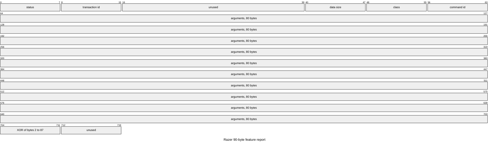

# Writing a protocol file

To read and write from a mouse we need a protocol, and in OpenSynapse that protocol is spread over two files.

- The device file in [`devices/`](devices/), which `opensynapse init` starts for you and the app reads to know how to talk to the mouse, has the USB ids, the interface, the transaction id, the profiles and layers, the max DPI and every button id with its name.
- The protocol file in [`devices/protocols/`](devices/protocols/) has the same name, and it's where you write down what you found out about the mouse and how. The app never reads it, because it's for the next person or agent who needs to know why the device file looks like that, or who has a similar mouse and wants a head start building something else.

> The protocol markdown file is purely so we could share the information with other people, since one of my goals with this project is to also categorize and document protocols for other Razer mice, so that if someone wants to add support for a new mouse they can do it without having to reverse engineer the protocol themselves. It's also useful for debugging and understanding how the device works.

If you're adding a mouse, please write one too, and the [Naga Left-Handed 2020 file](devices/protocols/razer-naga-left-handed-2020.md) is a complete example.

## Contents

- [The frame every Razer mouse shares](#the-frame-every-razer-mouse-shares)
- [Profiles](#profiles)
- [Finding things out](#finding-things-out)
- [Generating the file](#generating-the-file)
- [Template](#template)
- [Sources](#sources)
- [Using an agent](#using-an-agent)

## The frame every Razer mouse shares

You don't have to repeat this part in your file, only what's different on your mouse.

The mouse talks through a 90-byte HID feature report, usually on USB interface 0 and with no report id, laid out like this.

| Offset | Field |
|---|---|
| 0 | status, `00` when you send, then `02` ok, `01` busy, `03` fail or `05` unsupported in the reply |
| 1 | transaction id (`0x1f` on newer mice, older ones use `0xff` or `0x3f`) |
| 2..4 | unused |
| 5 | data size |
| 6 | command class |
| 7 | command id, bit `0x80` set means it's a read |
| 8..87 | arguments |
| 88 | XOR of bytes 2 to 87 |
| 89 | unused |

Here's the same layout as a diagram, where each square is one bit.



You send the report with `HIDIOCSFEATURE` and keep reading it back with `HIDIOCGFEATURE` until the status stops being busy, and OpenSynapse treats any status other than `01` and `02` as a rejected command. On Linux, hidraw wants one extra report id byte of `00` in front of the buffer, so you send 91 bytes, which `opensynapse probe` already does for you, and [devices/protocols/README.md](devices/protocols/README.md#creating-a-report) has a worked example of the bytes.

## Profiles

Mice with onboard memory keep their profiles in command class `0x05`, which has `0x80` for the profile count, `0x81` for the profile list, `0x84` for the active profile, `0x8a` for the max profiles, `0x02` to create, `0x03` to delete and `0x04` to set the active one, all with the data size at `01` except the list, which uses `0x50`.

The same ids show up in [freenapse](https://github.com/MatthewSaintBull/freenapse) for the Viper V3 Pro, where a mouse with a single profile answers a failure to the active profile read, and with different names for some of them in [razerqdhid](https://github.com/geezmolycos/razerqdhid/blob/main/docs/cmd_profile-en.md) for the Basilisk V3. [uchroma's reference](https://hyperb1iss.github.io/uchroma/reference/razer-protocol-reference.html) lists class `0x05` as profile management too, but with other command ids, and none of them say which models support it, so you can't assume every Razer mouse answers class `0x05`.

On the Naga Left-Handed 2020, the only mouse where this is confirmed, you have to create a profile with `0x02` before the firmware will switch to it, and profile `0` is the live copy of the active one. The [Naga file](devices/protocols/razer-naga-left-handed-2020.md#profiles-class-0x05) has the commands and their replies.

## Finding things out

This is where you work out what goes in your protocol file, so you'll find which command class and ids your mouse answers on, what arguments each one takes, which id is which button and how an action is written in bytes, and that's what fills the command, button and action tables, like the ones in the [Naga file](devices/protocols/razer-naga-left-handed-2020.md).

Always start with reads, since a read has the `0x80` bit set on the command id and doesn't change anything on the mouse, so you can try as many as you want.

You only need a hidraw node when more than one Razer device is plugged in, and `ls -l /sys/class/hidraw/ | grep -i 1532:<pid>` shows which node is which, so use the one whose path has `:1.0`, which is interface 0, or the interface `opensynapse init` printed.

1. Find the class with `opensynapse probe`, which tries every read command in classes `0x00` to `0x0f` and prints the ones that answer. With one Razer mouse plugged in it finds the right hidraw node and transaction id itself, like `init`, and prints which one it used, and with more than one it lists them so you can pass the node, like `opensynapse probe /dev/hidraw10`. It refuses to send anything that isn't a read and leaves the serial number out of its output. On the Naga the keymap is class `0x02`, DPI is `0x04` and serial/firmware are `0x00`, which seems to be common on newer Razer mice. When you pass a node the probe sends transaction id `0x1f`, so if the `firmware:` line doesn't say `status=ok`, pass the `transaction_id` from your device file with `--tid`, which `opensynapse init` prints, or try `--tid 0x3f` and `--tid 0xff` if you don't have one.
2. Look at what comes back with empty arguments, because some reads answer right away, like the Naga's `0x02/0x84` that lists every button id, and others need arguments.
3. Retry with arguments, since some reads only show up once you pass them, usually a profile, a button and a layer. For example, `opensynapse probe 0x02 --args 004000` sends profile 0, which is the live one that `opensynapse dump` shows, button `0x40` and layer 0 to every read in class `0x02`, and the `id 0x8c` line is that button's action, so just swap `40` for a button id from the `0x84` list.
4. Decode the answer against what you know, so if a thumb button sends `1` today and the reply ends in `1e`, that's the HID usage for `1` and you found the key byte. [devices/protocols/README.md](devices/protocols/README.md#manual-reading) walks through this on a real reply.

Only then try a write, with `opensynapse set` once you have a device file and only on one button, since `set` reads it back and errors if it didn't stick, and then press the button and set it back to what it was.

Keep in mind that **a write that reads back fine doesn't prove anything**, because the Naga stores almost any byte you send without checking it, so the only proof that an encoding does what you think is pressing the button and seeing it happen, which `opensynapse watch` shows once you have a device file.

## Generating the file

Once your device file works and `opensynapse dump` shows the right buttons, you don't have to start from an empty file, because this command writes most of it for you.

```sh
opensynapse protocol
```

It only reads from the mouse and writes `devices/protocols/<slug>.md`, where [the slug](CONTRIBUTING.md#adding-a-mouse) is something like `razer-naga-left-handed-2020`, or `./<slug>.md` when you're not in the repo root, with everything it can know on its own, which is the USB ids, firmware, interface, transaction id, a table with every button id and what it does on each layer, and the current DPI and stages. If the file already exists it stops, so edit that file or pass `--force` to start over. Everything only you can know is marked `TODO` for you to fill in, and the generated file has the sections of the [template](#template) except the keymap commands, so add those if you found them.

When it's done, send it with this command.

```sh
opensynapse protocol send
```

That opens a GitHub issue on this repo with your protocol file and your device file, using the [GitHub CLI](https://cli.github.com/) as your user. It asks before posting, `--dry-run` shows you what it would send and `--yes` skips the question, and if you don't have `gh`, it prints a link to open the issue by hand. When a maintainer labels the issue, a bot opens the PR that adds your mouse, and if you'd rather open a PR yourself, [CONTRIBUTING.md](CONTRIBUTING.md#adding-a-mouse) has the steps, while [devices/protocols/README.md](devices/protocols/README.md) shows what to do with a finished file.

## Template

If you want to write it by hand, copy this into `devices/protocols/<slug>.md`, with the same [slug](CONTRIBUTING.md#adding-a-mouse) as your device file, and fill it in, and if a section is the same as the Naga's, keep the heading and write "Same as the Naga" under it.

```markdown
# <Mouse name> keymap protocol

Device: USB `1532:xxxx`, firmware vX.Y. Device file: [`<slug>.jsonc`](../<slug>.jsonc).

How you found it: probing on Linux, a USB capture of Synapse, etc.

## Contents

- [Transport](#transport)
- [Keymap commands](#keymap-commands)
- [Button ids](#button-ids)
- [DPI](#dpi)
- [Action encoding](#action-encoding)
- [Unknowns](#unknowns)

## Transport

Interface, transaction id, anything that's different from the common frame in PROTOCOL.md.

## Keymap commands

| Command | Args | Status |
|---|---|---|
| `0x02/0x8c` get button | `[profile, button, layer]` | verified / inferred |

## Button ids

| Id | Button |
|---|---|

## DPI

The current DPI and stages, and anything that's different from the Naga's DPI commands.

## Action encoding

| Type | Bytes | Meaning |
|---|---|---|

## Unknowns

What you saw but couldn't explain, and what you didn't try.
```

Mark everything as **verified** when you saw it work on the mouse, or **inferred** when it read back right or matched another mouse but you didn't see it happen, because that difference is the most useful thing in the file.

## Sources

Before you probe, check what other people already found, since a lot of Razer mice share the same commands.

- [razerqdhid](https://github.com/geezmolycos/razerqdhid) (MIT) reverse engineered the Basilisk V3, which uses the same keymap commands as the Naga, and its docs cover [button actions](https://github.com/geezmolycos/razerqdhid/blob/main/docs/cmd_button-en.md), [macros](https://github.com/geezmolycos/razerqdhid/blob/main/docs/cmd_macro-en.md) and [profiles](https://github.com/geezmolycos/razerqdhid/blob/main/docs/cmd_profile-en.md), which is where most of the action types in the Naga file came from.
- [OpenRGB](https://gitlab.com/CalcProgrammer1/OpenRGB) (GPL-2.0-or-later) has the transaction id, interface and HID usage for almost every Razer device in `Controllers/RazerController/RazerDevices.cpp` and `RazerControllerDetect.cpp`, and the transaction ids `opensynapse init` tries, `0x1f`, `0x3f` and `0xff`, come from there.
- [OpenRazer](https://github.com/openrazer/openrazer) (GPL-2.0-or-later) has no button remapping, but its driver picks the transaction id per mouse in `driver/razermouse_driver.c`, and issues [#2845](https://github.com/openrazer/openrazer/issues/2845) (Basilisk Ultimate remapping) and [#2031](https://github.com/openrazer/openrazer/issues/2031) (keyboard remapping) have useful captures.

## Using an agent

You can have an agent, Claude Code or whatever you use, do the probing and write the file, so open it in this repo with the mouse plugged in and paste this prompt.

```text
Write the protocol file for my Razer mouse in opensynapse, the repo you're in.
Read PROTOCOL.md for what goes in it and the template, and
devices/protocols/razer-naga-left-handed-2020.md as an example.
My device file is ~/.config/opensynapse/devices/<vid-pid>/buttons.jsonc
(from `opensynapse init`), or the mouse already has a file in devices/. If
neither exists, say so and stop.

Rules:
- Only send GET commands (command id with bit 0x80 set), use `opensynapse probe`.
  Don't write anything to the mouse.
- Only write down what you actually saw. Mark each finding as verified
  (seen working on the mouse) or inferred (read back fine, or matches the
  Naga, but not seen working). Anything you couldn't explain goes under
  Unknowns.

Steps:
1. `opensynapse probe` finds the mouse itself when only one Razer device is
   plugged in. If there are more, find the /dev/hidraw node for the interface
   in my device file (`ls -l /sys/class/hidraw/`) and pass it to probe.
2. Run `opensynapse probe` over classes 0x00 to 0x0f and note which reads answer.
3. Read the button list (0x02/0x84), then run `opensynapse probe` on class 0x02
   with --args <profile><button><layer> and read the id 0x8c line for what
   each button does. Compare with my device file.
4. Ask me to press buttons while `timeout 20 opensynapse watch` runs if you
   need to confirm which id is which button.
5. Run `opensynapse protocol` to generate devices/protocols/<slug>.md
   and fill in every TODO with what you found. If that file already
   exists, edit it instead and never pass --force. Don't send it, I'll review
   it and run `opensynapse protocol send` myself.
```

Read what it wrote before you send it, because agents like to sound more sure than they are.
