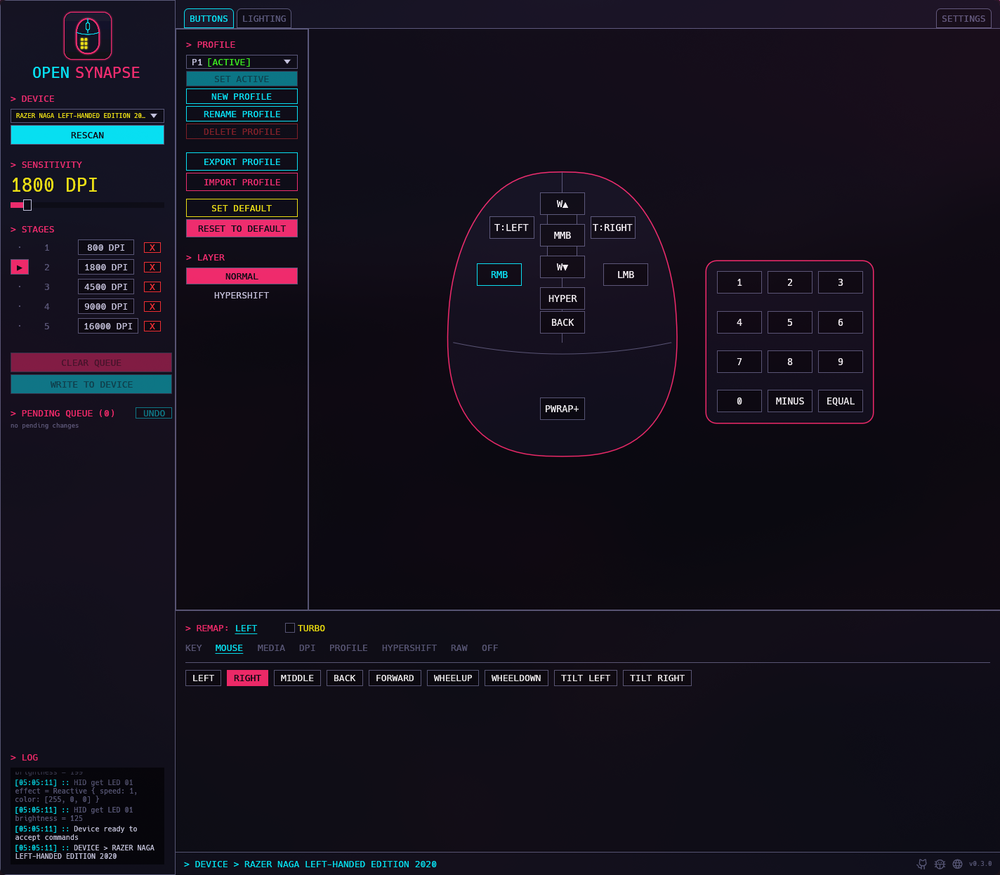
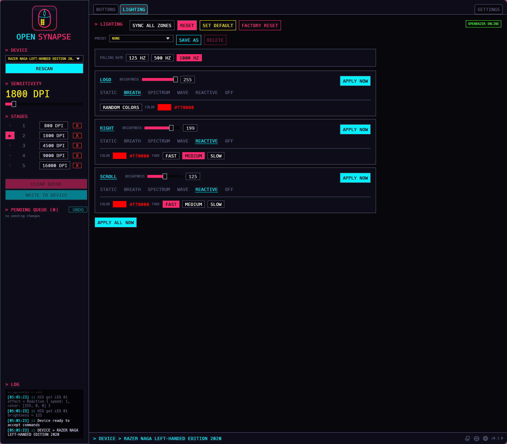

<p align="center"></p>

# opensynapse

> Remap buttons, set DPI and lighting on Razer mice from Linux.

> [!WARNING]
> **This is a work in progress.** It works on my mouse and that's about it for now. Expect things to change, break and get renamed.

My lawyers say I have to write this so:

> Not affiliated with, endorsed by, or supported by Razer Inc. Everything here is distributed as-is and with no warranty.

## What is it

Razer doesn't ship Synapse for Linux. keyd and friends can remap what the mouse sends, but the remap lives on the computer, not on the mouse, and some things you just can't reach that way. I also happen to have a Naga and a Linux, so that was pretty annoying.

This is the reverse engineered version of synapse with how the mouse stores its keymap (the details are in [`devices/protocols/`](devices/protocols/razer-naga-left-handed-2020.md)). It talks to the mouse directly, so the mapping is saved on the mouse itself and goes with it to any computer.

Right now you can:

- Remap any button to a key (with modifiers), a mouse button, a media key, DPI up/down, Hypershift or nothing at all, on both the normal and the Hypershift layer. Keys and mouse buttons can also be on turbo, so they repeat while you hold them
- Change DPI and the DPI stages
- Export and import profiles as JSON
- Go back to how the mouse was. The first time the GUI opens a mouse it saves every profile and the lighting to `~/.config/opensynapse/devices/<vid-pid>/` as `*.original.json`, ***RESET*** puts that back and ***SET DEFAULT*** makes what's on the mouse now the new original
- See which button you're pressing, live, in the GUI
- Change the lighting and brightness of zones. This one goes through [OpenRazer](https://openrazer.github.io/) (install `openrazer-driver-dkms` on Arch), so it works on any mouse OpenRazer supports. The GUI needs the OpenRazer daemon running and shows ***OPENRAZER ONLINE*** or ***OFFLINE*** on the lighting tab; `opensynapse rgb` also works with only the driver. The colors you see come from the mouse itself, so they match what it shows

In the GUI, every change goes to a queue until you hit ***WRITE TO DEVICE*** (lighting also has ***APPLY NOW***). CLI commands write right away.

On the Naga, profile 0 is the live one: it changes right away but is lost when you unplug the mouse. Profile 1 is stored on the mouse and is what it loads when you plug it in, so that's the one to edit if you want a change to stick.





## Current status

Only the **Razer Naga Left-Handed Edition 2020** (`1532:008d`) is supported, because that's the one I have. The protocol is shared by a bunch of Razer mice, so adding another one should mostly be writing a JSONC file (see [Adding your mouse](#adding-your-mouse)).

## Install

On Arch, it's on the AUR. The package also installs the udev rule, so you can skip the rest of this section:

```sh
yay -S opensynapse      # builds the latest release
yay -S opensynapse-bin  # same release, prebuilt
yay -S opensynapse-git  # builds the latest main
```

On Debian and Ubuntu, add the apt repository. The package also installs the udev rule:

```sh
curl -fsSL https://oss.lsantos.dev/opensynapse/apt/public.key | sudo gpg --dearmor -o /usr/share/keyrings/opensynapse.gpg
echo "deb [signed-by=/usr/share/keyrings/opensynapse.gpg arch=$(dpkg --print-architecture)] https://oss.lsantos.dev/opensynapse/apt stable main" | sudo tee /etc/apt/sources.list.d/opensynapse.list
sudo apt update && sudo apt install opensynapse
```

With Homebrew on Linux (then install the udev rule as `brew` tells you):

```sh
brew install khaosdoctor/tap/opensynapse
```

Every [release](https://github.com/khaosdoctor/opensynapse/releases) also has a `.deb`, an AppImage (GUI only) and a tar.gz with both binaries, for x86_64 and arm64. The `.deb` installs the udev rule; with the other two, install it as shown at the end of this section.

To build it yourself, you need [Rust](https://rustup.rs) and a Linux box. Then:

```sh
git clone https://github.com/khaosdoctor/opensynapse && cd opensynapse
cargo install --path . --features gui
```

That puts `opensynapse` (the CLI) and `opensynapse-gui` in `~/.cargo/bin`. If you only want the CLI, drop the `--features gui`.

Your user also needs access to the mouse's raw HID device, otherwise you'll get a permission denied:

```sh
sudo install -m644 udev/70-opensynapse.rules /etc/udev/rules.d/
sudo udevadm control --reload && sudo udevadm trigger
```

## Usage

The GUI is the easy way, just run `opensynapse-gui`. For headless use there's the CLI:

```sh
opensynapse dump                         # every button and what it does
opensynapse set thumb1 key:ctrl+1        # remap a button
opensynapse set thumb2 key:f13 --layer hypershift
opensynapse dpi 1600
opensynapse stages 800 1600 3200 --active 2
opensynapse export my-profile.json
opensynapse watch                        # prints buttons as you press them
opensynapse rgb all static ff00aa        # lighting, needs OpenRazer
opensynapse rgb scroll brightness 128
opensynapse init                         # start a device file for an unsupported mouse
opensynapse protocol                     # protocol file for your mouse, see PROTOCOL.md
opensynapse protocol send                # share it as a GitHub issue
```

`opensynapse help` has the rest.

## Adding your mouse

**I need your help here.** I only have one Razer mouse, so if you have another one, please add it. Every mouse is a single JSONC file (JSON with comments) with its USB ids and the list of buttons. `opensynapse init` writes most of it for you to `~/.config/opensynapse/devices/<vid-pid>/buttons.jsonc` by asking your mouse, without changing anything on it, and the finished ones go in [`devices/`](devices/).

[CONTRIBUTING.md](CONTRIBUTING.md) has the step by step, and a prompt you can paste into Claude Code (or whatever agent you use) to do the whole thing with it, which is how I did the Naga.

## AI usage

I used AI a lot on this, including for the reverse engineering part, and I checked everything against the real mouse, but there is probably something I missed. If you find it, open an [issue](https://github.com/khaosdoctor/opensynapse/issues).
