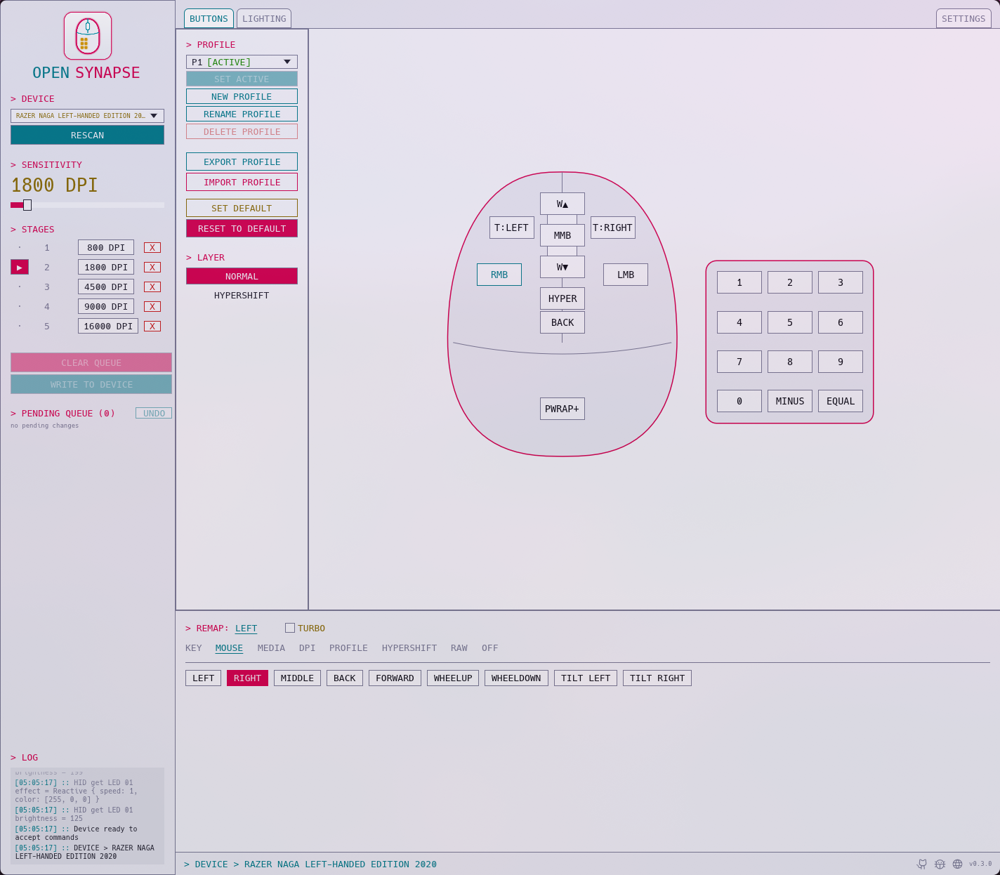

<p align="center"></p>

# opensynapse

> Remap buttons, set DPI and lighting on Razer mice from Linux.

> [!WARNING]
> **This is a work in progress.** I tested it on my mouse only, so edge cases might not be covered. It should work with any mice. See [First use](#first-use). It was also built with heavy AI help, see [AI usage](#ai-usage).

My lawyers say I have to write this so:

> Not affiliated with, endorsed by, or supported by Razer Inc. Everything here is distributed as-is and with no warranty.

## Contents

- [What is it](#what-is-it)
- [Install](#install)
- [First use](#first-use)
  - [In the GUI](#in-the-gui)
  - [With the CLI](#with-the-cli)
- [Usage](#usage)
- [Theming](#theming)
- [Adding your mouse](#adding-your-mouse)
- [AI usage](#ai-usage)

## What is it

Razer doesn't ship Synapse for Linux, to change the keybinds we can use keyd and the likes of it so we can remap what the mouse sends to the computer, but the remap sometimes miss buttons, some buttons are weird stuff (like keys that don't really exist) and the final remaps stay on the computer, not on the mouse. I also happen to have a Razer mice, and a Linux computer, so that was _pretty_ annoying... For... Years...

This is the reverse engineered version of the Synapse protocol handling. It maps out how the mouse stores its keymap (the details are in [`devices/protocols/`](devices/protocols/razer-naga-left-handed-2020.md)). It talks to the mouse directly, so the mapping is saved on the mouse itself and works in any computer, this is a single Rust binary either so you can probably build for whatever OS you have.

> This program uses userspace USB access, so it doesn't need root privileges.

One of the goals here is also to document these protocols, mouse by mouse, so nobody has to reverse engineer the same thing twice. If you want to build your own tool, or add a mouse to something else, the [protocol files](devices/protocols/) have what we found until now.

Right now you can:

- Remap any button to keys or other types of actions
- Normal and the Hypershift layers.
- Turbo mode support (repeats the action while the button is pressed)
- Change DPI and the DPI stages
- Create, delete, name and switch the profiles stored on the mouse
- Export and import profiles as JSON
- See which button you're pressing live if you have the GUI, which becomes some sort of tester
- Change the lighting and brightness of zones through [OpenRazer](https://openrazer.github.io/) (install `openrazer-driver-dkms` on Arch), so it works on any mouse OpenRazer supports.
- Save the lighting as named presets and load them back
- Change the polling rate, also through OpenRazer
- See the battery and set how long a wireless mouse waits before it sleeps




The lighting tab and every built-in theme, light and dark, are in the [theme gallery](docs/THEMING.md#gallery).

## Install

On Arch, from the AUR.

```sh
yay -S opensynapse      # builds the latest release
yay -S opensynapse-bin  # same release, prebuilt
yay -S opensynapse-git  # builds the latest main
```

On Debian and Ubuntu, from the apt repository.

```sh
curl -fsSL https://oss.lsantos.dev/opensynapse/apt/public.key | sudo gpg --dearmor -o /usr/share/keyrings/opensynapse.gpg
echo "deb [signed-by=/usr/share/keyrings/opensynapse.gpg arch=$(dpkg --print-architecture)] https://oss.lsantos.dev/opensynapse/apt stable main" | sudo tee /etc/apt/sources.list.d/opensynapse.list
sudo apt update && sudo apt install opensynapse
```

With Homebrew on Linux.

```sh
brew install khaosdoctor/tap/opensynapse
```

Every [release](https://github.com/khaosdoctor/opensynapse/releases) also has a `.deb`, an AppImage (GUI only, named `OpenSynapse-<version>-<arch>.AppImage`) and a tar.gz with both binaries, for x86_64 and arm64.

To build it yourself, you need [Rust](https://rustup.rs). Drop the `--features gui` if you only want the CLI.

```sh
git clone https://github.com/khaosdoctor/opensynapse && cd opensynapse
cargo install --path . --features gui
```

`cargo install` only copies the binaries, so they read the device files from the `devices/` folder of your clone. If you move or delete the clone, copy the file for your mouse from `devices/` to `~/.config/opensynapse/devices/1532-<pid>/buttons.jsonc` (`1532-pid` is the number for your hid device, for example, `1532-008d` is for the for the Naga, 1532 always defines a Razer device, so your mouse will be `1532-<something>`).

The AUR, apt and `.deb` packages install the udev rule, which is __very important__ for this to work. With anything else you need to install yourself, or you'll get a permission denied:

```sh
sudo install -m644 udev/70-opensynapse.rules /etc/udev/rules.d/
sudo udevadm control --reload && sudo udevadm trigger
```

This rule allows your user to access the mouse without root privileges during the session you're in.

## First use

If you just installed the udev rule, replug the mouse once. Then check that opensynapse sees it.

```sh
opensynapse list
```

Permission denied means the udev rule is missing or the mouse wasn't replugged. If your mouse isn't in the list, see [Adding your mouse](#adding-your-mouse).

### In the GUI

The first time `opensynapse-gui` sees your mouse it saves every profile on the mouse and the lighting as the original, so ***RESET TO DEFAULT*** always has something to go back to. ***NEW PROFILE*** starts as a copy of the active profile and saves its original, and ***DELETE PROFILE*** removes the profile's files and name.

The profile list shows the profiles stored on the mouse, and the active one is marked ***[ACTIVE]***. Changes to the active profile apply right away and stay after you replug the mouse. The mouse only switches to profiles that exist, so a profile button pointing at P3 does nothing until you create P3 with ***NEW PROFILE***. Names from ***RENAME PROFILE*** are kept on your computer, the mouse has no room for them.

If your mouse doesn't answer the profile commands, the profiles are presets saved on your computer in `~/.config/opensynapse/devices/<vid-pid>/<serial>-preset-<n>.json`, in the same format as ***EXPORT PROFILE***, with the active one remembered in `<serial>-preset-active.json`. What is on the mouse the first time becomes preset 1, and the active preset is read from the mouse on every start. You can keep up to 20. ***SET ACTIVE*** queues the preset's buttons and DPI, and ***WRITE TO DEVICE*** sends them. Editing a preset that isn't active only changes its file, and editing the active one also writes to the mouse (its first stored profile and P0) so it applies right away.

> [!IMPORTANT]
> The lighting tab needs the OpenRazer daemon running. The polling rate is 125, 500 or 1000 Hz, and ***SLEEP AFTER*** takes 60 to 900 seconds.

Lighting presets are saved in `~/.config/opensynapse/presets/<name>.json`.

#### The debug log

The LOG panel at the bottom of the sidebar shows everything the GUI sends to the mouse and what comes back, with known commands in words. The same lines go to `~/.local/state/opensynapse/debug.log` (or `$XDG_STATE_HOME/opensynapse/debug.log`), which ***DEBUG LOG*** on the settings tab opens, and to the systemd journal. The file starts empty on every launch and is deleted when the GUI exits normally. Turn on ***Show raw bytes in the log*** to see the bytes under each translated line. The same section turns line wrapping off and sets the log's font size.

```sh
journalctl -t opensynapse-gui -f        # follow it
journalctl -t opensynapse-gui -p err    # only errors
```

The file is gone once the GUI closes, so for a bug report save the journal instead and attach `opensynapse.log`:

```sh
journalctl -t opensynapse-gui -b > opensynapse.log   # everything since this boot
```

### With the CLI

Make a backup first.

```sh
opensynapse export before.json --profile 1 # backup
opensynapse set thumb1 key:f13 --profile 1 # change key to f13 on p1
opensynapse get thumb1 --profile 1 # should print key:f13
opensynapse import before.json --profile 1   # restores the backup
```

## Usage

```sh
opensynapse dump                         # every button and what it does
opensynapse set thumb1 key:ctrl+1
opensynapse set thumb2 key:f13 --layer hypershift
opensynapse dpi 1600
opensynapse stages 800 1600 3200 --active 2   # sets the DPI stages and activates the second stage
opensynapse profile                      # stored profiles and which one is active
opensynapse profile create 2             # also delete, switch and rename
opensynapse export my-profile.json
opensynapse watch                        # prints buttons as you press them
opensynapse rgb all static ff00aa        # sets rgb lights, needs OpenRazer
opensynapse rgb scroll brightness 128
opensynapse preset save night            # saves the current lighting as a preset
opensynapse preset load night            # also preset list and preset delete
opensynapse poll 1000                    # sets the poll rate in Hz, needs the OpenRazer daemon
opensynapse battery                      # for wireless mice, also shows the sleep timeout
opensynapse idle 300                     # sets seconds without movement before the mouse sleeps
opensynapse init                         # start a device file for an unsupported mouse
opensynapse probe                        # raw probe of your mouse to check what it has
opensynapse protocol                     # writes the protocol file, see PROTOCOL.md
opensynapse protocol send                # posts it as a public GitHub issue
```

CLI commands use profile 0 unless you pass `--profile`. Profile 0 is the live copy of the active profile, so changes there apply right away and are lost when you unplug the mouse.

> Every package installs shell completions for bash, zsh and fish. If you built it yourself, they're in [`contrib/completions/`](contrib/completions/).

## Theming

The GUI comes with a few themes and you can write your own in CSS, see [docs/THEMING.md](docs/THEMING.md).

## Adding your mouse

OpenSynapse reads a JSON file with your mouse's USB ids and its buttons when it starts. Yours goes in `~/.config/opensynapse/devices/<vid-pid>/buttons.jsonc`, and it wins over the ones every package installs from [`devices/`](devices). You don't need to wait for me or upload anything.

Run `opensynapse init` with the mouse plugged in. It only reads from the mouse and writes most of the file for you. Fix the `// TODO` lines, mostly naming the buttons.

```sh
opensynapse init
opensynapse list   # your mouse should be here now
```

**I need your help here though.** I only have one Razer mouse, so please send your file back. `opensynapse protocol send` opens a GitHub issue with it, or you can open a PR. [CONTRIBUTING.md](CONTRIBUTING.md) has the steps, and a prompt so an agent does it for you.

## AI usage

This was built with heavy AI help, and I'm not a Rust or firmware developer.

I'm a backend developer and I work with high-level languages. I had this problem for years and couldn't solve it on my own, so I used AI for the things I couldn't do by myself, and to help me write the rest. I tested everything on my own mouse, but I don't understand every line yet, and I'm learning how it works as I go.

If you're wondering whether it's safe to use:

- **It only changes settings, never firmware.**
- **Everything can be undone.** The original state of the mouse is saved, and you can import it back anytime.
- **It runs as your user, not root.**
- **The protocol is documented** in [`PROTOCOL.md`](PROTOCOL.md) and [`devices/protocols/`](devices/protocols/).
- **It's tested on real hardware.** I use it on my own mouse every day.

There are probably mistakes I didn't catch. If you find one, open an [issue](https://github.com/khaosdoctor/opensynapse/issues). If you know Rust or HID and want to review the code, that's even better. If AI-built software is a dealbreaker for you, that's fair, no hard feelings.
